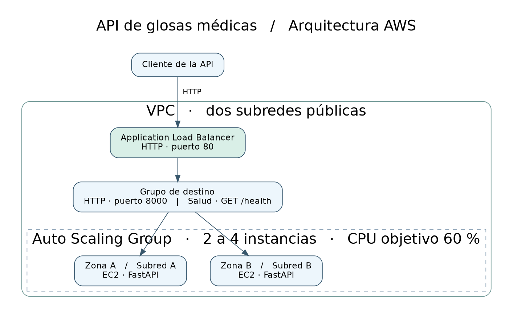

# Despliegue en AWS: API `/predict` de glosas

## Despliegue y evidencia en un comando

Sube la copia para publicar, repo_publicable.zip, a AWS CloudShell en la región elegida. Desde una carpeta nueva, ejecuta:

```bash
unzip repo_publicable.zip
cd repo
bash scripts/desplegar_y_verificar.sh
```

El script aprovisiona recursos facturables en la VPC predeterminada, usa dos instancias t3.micro y espera dos destinos sanos. El ZIP de evidencia se guarda en tu carpeta personal. Descárgalo antes de eliminar el stack. Para detener los cargos de esta infraestructura, ejecuta en la misma región:

```bash
aws cloudformation delete-stack --stack-name glosas-api
aws cloudformation wait stack-delete-complete --stack-name glosas-api
```

## Arquitectura
Internet → **Application Load Balancer** (puerto 80) → **Auto Scaling Group** (2 a 4 instancias EC2 en 2 zonas de disponibilidad, API FastAPI en el puerto 8000).
El ALB comprueba `GET /health`; las instancias solo aceptan tráfico del ALB (security group). Escala por CPU (objetivo 60 %).
Acceso a las instancias por SSM Session Manager (sin SSH abierto).

## Pasos (consola o CLI)
1. En la región elegida (por ejemplo, us-east-1), busca la VPC por defecto y dos subredes públicas en zonas distintas.
2. CloudFormation → *Create stack* → subir `infra/template.yaml`. Parámetros: `VpcId`, `SubnetIds` (2), `InstanceType` (`t3.micro`), `ModelS3Uri` (vacío por ahora).
   CLI equivalente:
   ```bash
   aws cloudformation deploy --stack-name glosas-api --template-file infra/template.yaml \
     --capabilities CAPABILITY_IAM \
     --parameter-overrides VpcId=vpc-xxxx SubnetIds=subnet-aaa,subnet-bbb
   ```
3. Esperar `CREATE_COMPLETE` (≈5–8 min). En *Outputs* sale `UrlApi`.
4. Probar:
   ```bash
   curl http://<UrlApi>/health
   curl -X POST http://<UrlApi>/predict -H "Content-Type: application/json" \
     -d '{"motivo":"DIFERENCIAS DE VALOR","especialidad":"MEDICINA GENERAL","entidad":"FAMISANAR","valor_objetado":250000,"regimen":"CON","centro_costo":"URGENCIAS"}'
   ```
5. **Cuando tengas tu clasificador:** guarda un *pipeline* de scikit-learn con `joblib.dump(pipeline, "model.joblib")`, súbelo a S3 y actualiza el stack con `ModelS3Uri=s3://tu-bucket/model.joblib`. Usa únicamente un artefacto de entrenamiento propio y versiones compatibles de scikit-learn y sus dependencias. Las columnas deben llamarse como en `app/app.py`. Las clases admitidas son Recuperada/No recuperada o 0/1, con 1 para no recuperada.
   Mientras tanto la API usa una regla base (valor ≥ 100.000 COP = prioridad alta; predicción y probabilidad quedan en null) y lo declara en el campo `modelo`.
6. **Al terminar, borra el stack** (CloudFormation → *Delete*) para que no siga cobrando.

## Evidencia para el informe
- [ ] Stack en `CREATE_COMPLETE` (pestaña *Events* con la hora)
- [ ] EC2 → Target Groups → 2 targets en **healthy**
- [ ] Respuesta de `/health` y de `/predict` (captura de la terminal con la URL del ALB)
- [ ] Auto Scaling Group con capacidad 2/2
- [ ] Cost Explorer filtrado por servicio, si se solicita un informe de costos
- [x] Diagrama de arquitectura incluido en esta guía
- [ ] Estimación del Pricing Calculator, si se solicita

## Costos de la práctica

Para estimar el costo en la región elegida, introduce en AWS Pricing Calculator dos instancias t3.micro, dos volúmenes gp3 de 20 GiB, un Application Load Balancer, sus unidades de capacidad y las IPv4 públicas durante las horas de uso. Un evento de escalado puede aumentar el número de instancias hasta cuatro. Durante la demostración utiliza cargas de ejemplo. Conserva la evidencia y elimina el stack al terminar.

## Diagrama del diseño



El grupo de seguridad de las instancias abre el puerto 8000 únicamente al grupo del balanceador. El diagrama representa la capacidad inicial de dos instancias.

## Guardar evidencia de la ejecución

En AWS CloudShell, selecciona la región del despliegue y abre la carpeta del repositorio. Tras ejecutar el paso 2 y esperar el estado CREATE_COMPLETE, comprueba que ambos destinos estén healthy. Ejecuta:

```bash
bash scripts/evidencia_aws.sh glosas-api
```

Entrega los cinco JSON de la carpeta fechada en `evidencia/aws/`. Revisa que el stack esté creado, que ambos destinos estén sanos y que las dos respuestas de la API contengan resultados. Si los destinos siguen arrancando, espera y repite el comando. Guarda las evidencias antes de eliminar el stack.

El escenario mensual de referencia, con desglose por servicio, figura en la sección V de [avance_tecnico_IEEE.pdf](avance_tecnico_IEEE.pdf).
